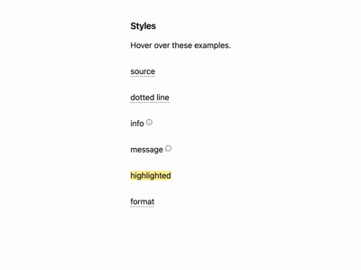

# Tooltip classic

Tooltip classic is an Obsidian tooltip plugin. Add a short note, explanation, or link to a word, then hover over the word or its icon to see it in a tooltip. 100% customizable, no ads, no login, no paywall.



## Install

1. In Obsidian, open **Settings → Community plugins**, reload the plugin list, and enable **Tooltip classic**.
2. Manual installation: Download the latest release and unzip the `tooltip-classic` folder into `.obsidian/plugins/` inside your vault. On a Mac, press **Command + Shift + .** in Finder to show hidden folders.

Requires Obsidian Desktop 1.15.0 or later.

## Try it

Write this in a note, then hover over **hello** in Reading view or Live Preview.

```markdown
{hello/This is a tooltip.}
```

Open **Settings → Tooltip classic** to change the default style and colors. To pick a style for just one tooltip, add a prefix.

| **Example**                  | **Style**          |
| ---------------------------- | ------------------ |
| `{d/hello/Dotted underline}` | Dotted underline   |
| `{t/hello/Info icon}`        | Circled “i”        |
| `{b/hello/Speech bubble}`    | Speech-bubble icon |
| `{h/hello/Highlighted word}` | Highlight          |


The prefix letters are optional. With the default settings, `{source/description}` displays the word with a dotted underline.

Use Markdown in the description, including **bold**, *italic*, `code`, highlighting, links, and note links. Put `&` between parts to show them on separate lines while keeping the annotation on one line in your note.

```markdown
{t/source/**Read more** & [Website](https://example.com) & [[Note|Open the note]]}
```

Move your mouse into the tooltip to select text or follow a link. Use Tab to focus its trigger and Escape to close it. In Live Preview, put the cursor on the annotation to edit its source.

## Privacy and source

The plugin saves its settings locally and includes no telemetry, ads, accounts, or payments. [MIT License](https://github.com/m1france/tooltip-classic/blob/main/LICENSE) · [Build and release instructions](https://github.com/m1france/tooltip-classic/blob/main/docs/RELEASING.md)
